# Pileup tensor 36채널 — 계산 방법과 해석

**기준: 2026-11-25의 `to_tgil_전달용` 코드임. Short/Long의 새 실행 기본 모드는 `pileup_feature`이며, 한 HAP의 한 위치마다 36개 수치를 저장함.**

- 구성: 공통 18개 + HP1 전용 9개 + HP2 전용 9개 = **36채널**임.
- 저장 순서: 공통 13개(forward·reverse 포함) → HP1 9개 → HP2 9개 → BAF 3개 → non-ref 2개임. 의미별 묶음인 ‘공통 18개’가 배열에서 모두 연속된 것은 아님.
- 그림은 개요 4장과 [전체 36채널의 상세 그림 18장](#feature-atlas)으로 구성함. 개요는 8-read/3-read, 상세는 별도의 12-read/8-read 예시임. 모든 수치는 실제 계산 코드·HTSlib 검증 경로로 확인한 교육용 합성값이며 실제 donor의 측정값이 아님.
- 채널 번호는 **0부터 시작하는 배열 열 번호**임. 숫자 0의 해석에는 depth·좌표·BAF 보조 배열이 필요함.

## 1. Readset과 달라지는 부분

| 구분 | Readset sequence (`full`) | Pileup tensor (`pileup_feature`) |
|---|---|---|
| WGS read의 표현 | 개별 read 서열·품질·위치 정보를 보존함 | 한 위치에서 관측된 read를 세어 36개 수치로 요약함 |
| WGS 관측 기준 | 개인 HAP에 정렬된 read를 사용함 | 공통 reference에 정렬된 read에서 관측값을 계산함 |
| HAP와의 연결 | HAP 정렬 결과의 좌표를 사용함 | 기존 consensus chain으로 reference 관측을 HAP 위치에 대응함 |
| 한 read의 연속 정보 | 한 read 안의 염기 연결 관계가 남음 | 위치별 집계이므로 개별 read 복원·장거리 read 연결 정보는 남지 않음 |
| 삽입 정보 | 개별 read의 삽입 서열을 추적할 수 있음 | 왼쪽 anchor의 삽입 사건 지지를 기록함. 삽입 allele 일치율이나 삽입 염기별 depth는 계산하지 않음 |

개인의 HAP1·HAP2 DNA 서열은 함께 보존함. Pileup 수치는 **HAP 서열과 read 관측을 서로 다른 정보로 제공하는 것**임. 이 문서는 WGS pileup feature를 설명하며 RNA expression 채널의 설명서는 아님.

## 2. 먼저 한 위치에서 무엇을 세는지 보기

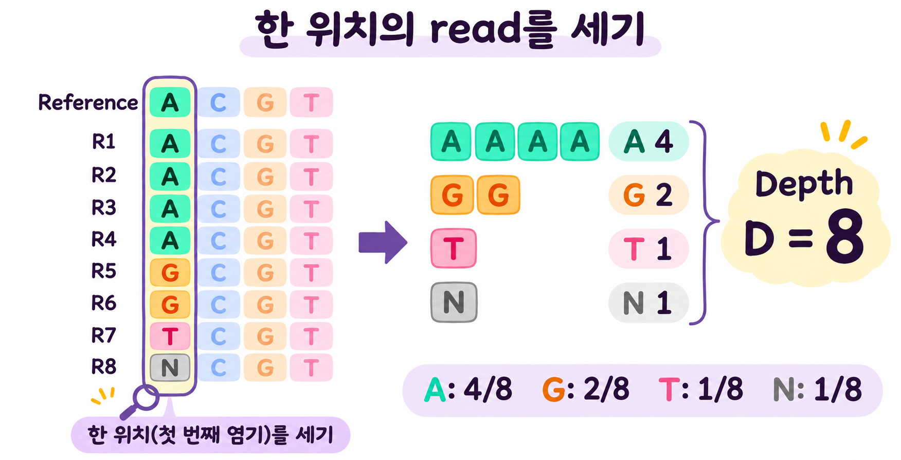

그림 1의 reference 염기는 A임. 아래 read 8개가 같은 위치를 덮고 있고, 그 위치의 관측은 **A 4개, G 2개, T 1개, N 1개**임. 오른쪽 비율은 이 한 위치의 관측 비율임. Reference 행 자체는 read 수에 포함하지 않음.

### 계산에 쓰는 기호

아래 기호는 **필터를 통과한 primary 정렬의 한 reference 위치**에 대해 정의함.

| 기호 | 뜻 | 포함·제외 범위 |
|---|---|---|
| `A, C, G, T, N` | 해당 염기를 관측한 개수임 | CIGAR `M`, `=`, `X`로 이 위치에 대응한 read 염기임 |
| `D` | `A+C+G+T+N`인 base depth임 | N 포함, deletion span·reference skip 제외임 |
| `S` | 이 위치를 deletion으로 지나가는 정렬 수임 | CIGAR `D`의 삭제 구간을 덮는 수임. 염기 관측인 `D`와 다름 |
| `I` | 이 위치 바로 뒤의 삽입 사건 수임 | 왼쪽 anchor에 기록하는 CIGAR `I` 사건 수임 |
| `E` | 이 위치 바로 뒤에서 시작하는 결실 사건 수임 | 왼쪽 anchor에 기록하는 CIGAR `D` 사건 수임 |
| `Lmax` | 이 위치 뒤에서 시작하는 결실 길이의 최댓값임 | read CIGAR에서 관측한 bp 길이임 |
| `F`, `R` | forward·reverse 방향의 염기 관측 수임 | `F+R=D`임. 생물학적 유전자 가닥을 뜻하지 않음 |
| `Dq` | 실제 BQ 값이 있는 염기 관측 수임 | QUAL 없음·BQ 255는 제외함. BQ 0은 유효한 값임 |
| 아래첨자 `1`, `2` | 정수 HP 태그가 1·2인 read의 집계임 | 예: `D1`은 HP1 read만으로 계산한 depth임 |

**분모가 0이면 해당 수치는 0으로 저장함. 0이 ‘관측 없음’인지 ‘실제로 비율 0’인지는 보조 배열로 구분함.** NaN·inf로 저장하지 않음.

### 그림 1을 자세한 계산 예제로 확장함

| Read | 관측 염기 | HP 태그 | MAPQ | BQ | 정렬 방향 |
|---|---|---|---:|---:|---|
| R1 | A | 1 | 60 | 40 | forward |
| R2 | A | 1 | 60 | 30 | forward |
| R3 | A | 1 | 50 | 20 | forward |
| R4 | A | 1 | 50 | 10 | forward |
| R5 | G | 2 | 40 | 30 | reverse |
| R6 | G | 2 | 40 | 30 | reverse |
| R7 | T | 없음 | 30 | 20 | forward |
| R8 | N | 없음 | 30 | 없음 | reverse |

- 전체: `D=8`, `F=5`, `R=3`, `Dq=7`임.
- HP1: `D1=4`이고 모두 A임. HP2: `D2=2`이고 모두 G임. HP 미지정 2개는 전체 집계에만 들어감.
- VCF: 같은 위치의 `REF=A`, `ALT=G`, `GT=0|1`인 예시임.
- 삽입·결실은 이 8-read 예시에는 없음. 해당 채널은 뒤의 **별도 3-read 예시**로 설명함.

## 3. 공통 채널: 전체 read의 관측

‘공통’은 샘플 간 공통값이라는 뜻이 아님. **한 샘플의 HP1·HP2·HP 미지정 read를 합친 집계**임.

### 3.1 `log1p_depth` — 채널 0

- 뜻: 한 위치의 base depth를 로그로 압축한 수치임.
- 계산: `ln(1+D)`임. 자연로그를 사용하며 `D=0`이면 0임.
- 예시: `ln(9) ≈ 2.1972`임. 원래 read 개수 8은 보조 배열 `depth`에 정수로 따로 저장함.
- 해석: depth가 클수록 증가하되 높은 depth의 값 차이를 완만하게 표현함. 비율이 아니며 1보다 클 수 있음.

### 3.2 `mean_mapq` — 채널 1

- 뜻: 이 위치에 염기를 제공한 정렬의 평균 mapping quality임.
- 계산: `MAPQ 합 / D`임. 같은 read가 덮는 여러 위치에서는 각 위치에 그 read의 MAPQ가 기여함.
- 예시: `(60+60+50+50+40+40+30+30)/8 = 45`임.
- 해석: 원래 MAPQ의 수치 단위를 유지함. 0–1 정규화나 확률 변환을 하지 않음. 입력 MAPQ 255를 별도 결측으로 바꾸는 규칙은 현재 없음.

### 3.3 `mean_baseq` — 채널 2

- 뜻: 이 위치에서 관측된 염기의 평균 base quality임.
- 계산: `유효 BQ 합 / Dq`임. **depth 전체가 아니라 BQ가 실제 존재하는 관측 수**가 분모임.
- 예시: `(40+30+20+10+30+30+20)/7 ≈ 25.7143`임. R8은 depth에는 포함되지만 BQ 평균의 분모에서는 제외함.
- 해석: 원래 BQ 수치를 유지함. 모든 QUAL이 없으면 평균은 0, `baseq_depth`도 0임. 실제 BQ 0과 결측을 구분할 때 이 보조 배열을 사용함.

### 3.4 `strand_forward_ratio` — 채널 3

- 뜻: 이 위치의 염기 관측 중 forward 정렬에서 온 비율임.
- 계산: `F/D`임. 예시: `5/8 = 0.625`임.
- 해석: 정렬 FLAG의 방향 정보임. RNA sense/antisense, 유전자 전사 방향, read-pair의 read1/read2 비율이 아님.

### 3.5 `strand_reverse_ratio` — 채널 4

- 뜻: 이 위치의 염기 관측 중 reverse 정렬에서 온 비율임.
- 계산: `R/D = (D−F)/D`임. 예시: `3/8 = 0.375`임.
- 해석: `D>0`인 reference 대응 위치에서 forward+reverse는 1임. `D=0`이면 둘 다 0임. 공통 forward를 다시 추가하지 않고 reverse만 보완한 채널임.

### 3.6 A/C/G/T/N 관측 비율 — 채널 5–9

분모는 모두 `D`임. VCF의 REF·ALT 지정 여부와 무관하게 **실제로 관측된 염기 자체**를 셈.

| 채널 | 이름 | 계산 | 8-read 예시 | 해당 수치가 알려주는 것 |
|---:|---|---|---:|---|
| 5 | `read_A_ratio` | `A/D` | `4/8 = 0.5` | A 염기 관측의 비율임. A가 REF가 아닌 위치에서도 같은 계산임 |
| 6 | `read_C_ratio` | `C/D` | `0/8 = 0` | C 염기 관측의 비율임. depth가 있는데 C만 없으면 0임 |
| 7 | `read_G_ratio` | `G/D` | `2/8 = 0.25` | G 염기 관측의 비율임. VCF ALT가 G인 경우에도 BAF와는 분모가 다를 수 있음 |
| 8 | `read_T_ratio` | `T/D` | `1/8 = 0.125` | T 염기 관측의 비율임. 예시의 T는 VCF REF·ALT 어느 쪽도 아니지만 이 채널에는 반영됨 |
| 9 | `read_N_ratio` | `N/D` | `1/8 = 0.125` | **read에서 N으로 관측된 비율**임. HAP DNA sequence의 N 비율과 별개의 값임 |

각 값은 0–1 범위임. `D>0`이면 다섯 비율의 합은 1임. Deletion이나 soft-clipped 염기는 여섯 번째 염기처럼 이 분모에 추가하지 않음.

### 3.7 삽입·결실 사건 채널 — 채널 10–12

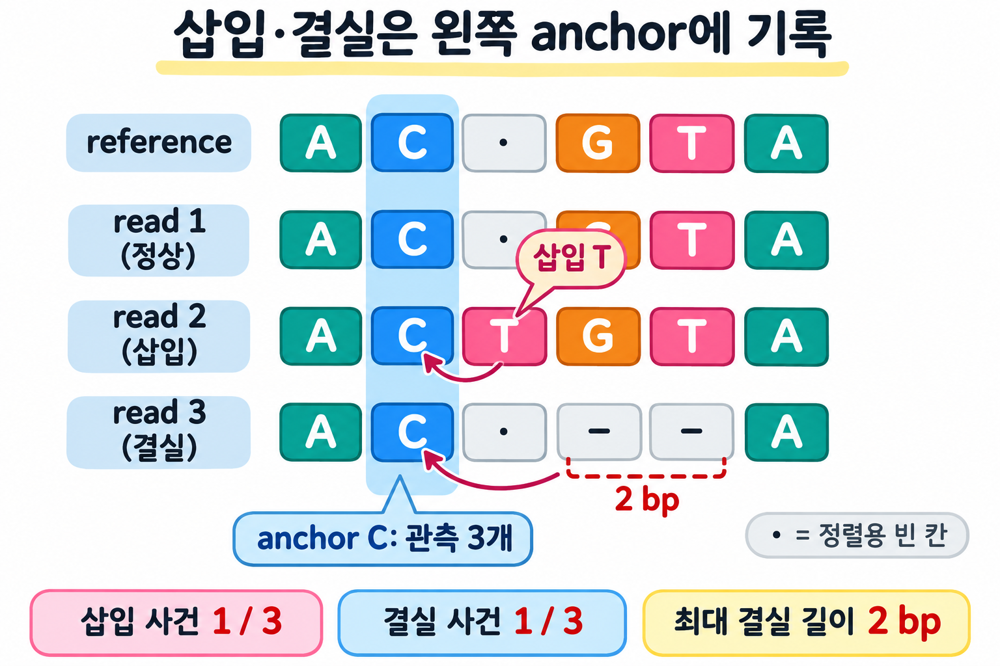

그림 2는 앞의 8-read와 다른 예시임. Reference는 `ACGTA`이며, 정상 read 1개·T가 삽입된 read 1개·GT 2bp가 결실된 read 1개를 사용함. 그림의 `·`는 정렬을 보여주기 위한 빈 칸이며 실제 염기가 아님.

- Anchor C: 세 read 모두 C를 관측하므로 `D=3`, `S=0`임. C 바로 뒤에서 `I=1`, `E=1`, `Lmax=2`임.
- 결실된 reference G·T 위치: 정상·삽입 read가 염기를 제공하므로 `D=2`, 결실 read 1개가 지나가므로 `S=1`임.
- **결실 사건의 시작을 anchor에 기록하는 것과, 결실이 덮는 위치의 `S`를 세는 것은 서로 다른 집계임.** 결실 길이 2bp를 사건 2회로 세지 않음.

| 채널 | 이름 | 계산 | Anchor C의 값 | 해석 |
|---:|---|---|---:|---|
| 10 | `insertion_ratio` | `I/(D+S)` | `1/3 ≈ 0.3333` | 이 anchor 바로 뒤의 삽입 사건 지지임. 삽입된 염기 수나 특정 삽입 allele 일치율이 아님 |
| 11 | `deletion_after_event_ratio` | `E/(D+S)` | `1/3 ≈ 0.3333` | 이 anchor 바로 뒤에서 **시작하는 결실 사건**의 지지임. 이 위치 자체가 결실된 비율이 아님 |
| 12 | `deletion_after_max_len` | `max(이 anchor 뒤의 각 결실 길이)` | `2 bp` | 관측된 결실 중 가장 긴 길이임. 평균·합계·VCF 결실 길이가 아님. 사건이 없으면 0임 |

계산은 reference 정방향에서 바로 왼쪽의 염기 위치를 anchor로 사용함. Reverse read라고 오른쪽 anchor로 바꾸지 않음. 연속된 동일 CIGAR 연산은 합쳐 한 사건으로 셈. Read 시작 앞쪽에 유효한 anchor가 없는 leading insertion/deletion에는 사건을 억지로 만들지 않음.

사건 비율은 사건 수를 분자로 사용하며 별도의 1 상한으로 자르지 않음. 통상적인 단일 사건 예시에서는 0–1이나, 같은 anchor에 복수 CIGAR 사건이 생기는 특수 입력까지 항상 1 이하라고 보장하는 수치는 아님. 최대 결실 길이는 `float32` 채널 외에 정수 `max_deletion_length`로도 보존함.

## 4. HP1·HP2 채널: read 집단을 나누어 같은 관측을 계산함

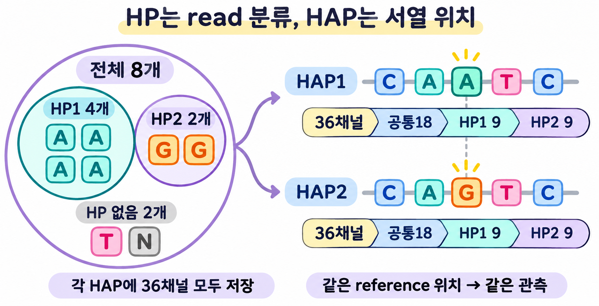

- **HP1/HP2**: 입력 BAM의 정수 `HP=1/2` 태그를 가진 read 집단임. 태그가 없거나 1·2가 아니면 공통 집계에만 포함함.
- **HAP1/HAP2**: DNA 서열 및 그 서열 위의 위치를 의미함. Feature 채널의 HP 번호와 저장 위치의 HAP 이름은 다른 축임.
- HP1 read 하나는 공통 집계와 HP1 집계에 함께 기여함. 공통/HP1/HP2를 서로 독립된 세 read 집단으로 더하면 중복 집계가 됨.
- 그림의 공통 18개·HP1 9개·HP2 9개 리본은 의미별 묶음임. 실제 저장 순서는 8절에 설명함.
- **각 HAP의 한 위치에 36채널 모두 저장함. HP1 9개를 HAP1에만, HP2 9개를 HAP2에만 저장하는 방식이 아님.** 같은 reference 위치에 대응하면 두 HAP 위치는 같은 36개 관측값을 받음.

### 4.1 HP1 전용 9개 — 채널 13–21

아래 `A1…N1`, `D1`, `S1`, `I1`, `E1`, `Lmax1`은 HP1 read만 사용한 수치임. 분모를 전체 depth로 나누지 않음.

| 채널 | 이름 | 계산 | 예시 | 해석 |
|---:|---|---|---|---|
| 13 | `hp1_log1p_depth` | `ln(1+D1)` | 8-read: `ln(5) ≈ 1.6094` | HP1 염기 관측량임. 전체 depth에 대한 HP1 비율은 아님 |
| 14 | `hp1_read_A_ratio` | `A1/D1` | 8-read: `4/4 = 1` | HP1 관측 안에서 A가 차지하는 비율임 |
| 15 | `hp1_read_C_ratio` | `C1/D1` | 8-read: `0/4 = 0` | HP1 관측 안에서 C가 차지하는 비율임 |
| 16 | `hp1_read_G_ratio` | `G1/D1` | 8-read: `0/4 = 0` | HP1 관측 안에서 G가 차지하는 비율임 |
| 17 | `hp1_read_T_ratio` | `T1/D1` | 8-read: `0/4 = 0` | HP1 관측 안에서 T가 차지하는 비율임 |
| 18 | `hp1_read_N_ratio` | `N1/D1` | 8-read: `0/4 = 0` | HP1 read의 N 관측 비율임. HAP1 DNA의 N 함량과 다름 |
| 19 | `hp1_insertion_ratio` | `I1/(D1+S1)` | 3-read anchor: `1/2 = 0.5` | HP1 read의 삽입 사건 지지임. 예시에서 정상·삽입 read를 HP1로 둠 |
| 20 | `hp1_deletion_after_event_ratio` | `E1/(D1+S1)` | 3-read anchor: `0/2 = 0` | HP1 read에서 anchor 바로 뒤에 시작한 결실 사건 지지임 |
| 21 | `hp1_deletion_after_max_len` | `Lmax1` | 3-read anchor: `0 bp` | HP1 read에서 시작한 최대 결실 길이임. 예시에는 해당 사건이 없음 |

### 4.2 HP2 전용 9개 — 채널 22–30

아래 기호는 모두 HP2 read만 사용함. 3-read indel 예시에서는 결실 read 하나를 HP2로 둠.

| 채널 | 이름 | 계산 | 예시 | 해석 |
|---:|---|---|---|---|
| 22 | `hp2_log1p_depth` | `ln(1+D2)` | 8-read: `ln(3) ≈ 1.0986` | HP2 염기 관측량임. HAP2 서열의 길이나 전체 read 비율이 아님 |
| 23 | `hp2_read_A_ratio` | `A2/D2` | 8-read: `0/2 = 0` | HP2 관측 안에서 A가 차지하는 비율임 |
| 24 | `hp2_read_C_ratio` | `C2/D2` | 8-read: `0/2 = 0` | HP2 관측 안에서 C가 차지하는 비율임 |
| 25 | `hp2_read_G_ratio` | `G2/D2` | 8-read: `2/2 = 1` | HP2 관측 안에서 G가 차지하는 비율임 |
| 26 | `hp2_read_T_ratio` | `T2/D2` | 8-read: `0/2 = 0` | HP2 관측 안에서 T가 차지하는 비율임 |
| 27 | `hp2_read_N_ratio` | `N2/D2` | 8-read: `0/2 = 0` | HP2 read의 N 관측 비율임. HAP2 DNA의 N 함량과 다름 |
| 28 | `hp2_insertion_ratio` | `I2/(D2+S2)` | 3-read anchor: `0/1 = 0` | HP2 read의 삽입 사건 지지임 |
| 29 | `hp2_deletion_after_event_ratio` | `E2/(D2+S2)` | 3-read anchor: `1/1 = 1` | HP2 read에서 anchor 바로 뒤에 시작한 결실 사건 지지임 |
| 30 | `hp2_deletion_after_max_len` | `Lmax2` | 3-read anchor: `2 bp` | HP2 read에서 시작한 가장 긴 결실의 길이임 |

HP별 base depth가 0이면 그 집단의 base 비율·로그 depth는 0임. 유효한 HP 태그가 없는 샘플에서는 HP 채널이 0이어도 공통 채널에는 충분한 관측이 있을 수 있음. HP별 평균 MAPQ·BQ·strand·BAF는 별도 채널로 추가하지 않음.

`hp1_depth + hp2_depth ≤ depth`임. 차이는 유효 HP 태그가 없는 primary 염기 관측 수임. HP1/2 번호 자체를 전체 유전체에서 항상 부계/모계라고 해석하지 않음. 입력 phasing·태그의 근거와 phase block을 함께 고려해야 함.

## 5. VCF REF·ALT 기반 채널: BAF 관련 3개

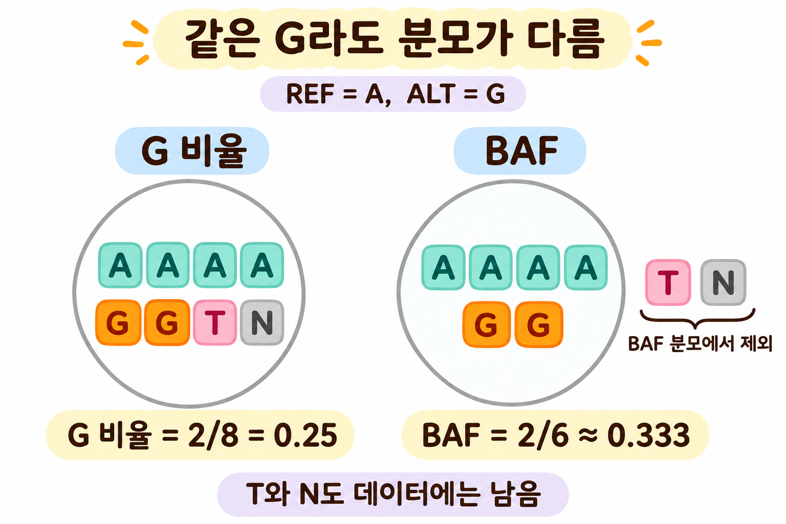

그림 4에서 `read_G_ratio=2/8`이지만 `baf=2/6`임. VCF가 `REF=A, ALT=G`로 정의했으므로 **BAF의 분모는 A와 G만 더한 6개**임. T와 N 관측을 read·window에서 제거하는 것이 아니라 **이 BAF 계산의 분모에서만 제외함.**

### 5.1 `vcf_ref_allele_fraction` — 채널 31

- 뜻: VCF가 정의한 두 allele 중 REF를 지지하는 관측 비율임.
- 계산: `nREF / (nREF+nALT)`임.
- 예시: `A/(A+G) = 4/6 ≈ 0.6667`임.
- 해석: `read_A_ratio=4/8`과 다름. 유효한 BAF 위치에서 관측이 있으면 이 값과 `baf`의 합은 1임.

### 5.2 `baf` — 채널 32

- 뜻: 현재 코드에서 BAF는 **VCF의 ALT allele을 지지하는 관측 비율**로 정의함.
- 계산: `nALT / (nREF+nALT)`임.
- 예시: `G/(A+G) = 2/6 ≈ 0.3333`임.
- 해석: 최대 non-reference 비율, HP2 read 비율, VCF genotype 자체가 아님. GT가 이형접합이어도 관측 BAF가 정확히 0.5일 필요는 없음.

### 5.3 `minor_allele_fraction` — 채널 33

- 뜻: 그 위치에서 관측한 REF·ALT 두 비율 중 작은 값임.
- 계산: `min(vcf_ref_allele_fraction, baf)`임.
- 예시: `min(4/6, 2/6) = 2/6 ≈ 0.3333`임.
- 해석: 유효 관측에서 0–0.5 범위임. ALT가 더 많으면 REF 쪽이 minor가 될 수 있음. **집단 데이터에서 추정하는 population MAF가 아님.**

### 어느 VCF 위치에서 계산하는가?

- 개인 sequence VCF에서 **서로 다른 두 A/C/G/T 단일 염기 allele**로 정의된 biallelic SNV만 사용함.
- 해당 sample의 diploid GT가 존재하고 두 값이 각각 0 또는 1이어야 함. `0/0`, `0/1`, `1/1`도 지원하며 BAF 계산 자체가 이형접합·phased GT로만 제한되는 것은 아님.
- Indel·다중 ALT·missing/비정상 GT·동일 위치의 중복 record는 이 BAF site에서 제외함. Read/window를 버리는 조건이 아님.
- 이 조회 함수 자체에 추가 VCF `FILTER=PASS` 조건은 없음. 실제 입력은 앞 단계에서 준비한 개인 sequence VCF임.
- VCF의 REF와 실제 reference 염기가 다르면 BAF를 임의로 계산하지 않고 오류로 처리함.
- `baf_site=1`은 지원하는 site임. `baf_heterozygous=1`은 그 site의 GT가 이형접합임. **`baf_valid=1`이어야 REF·ALT 관측 분모가 실제로 양수임.**
- Site가 없거나 REF·ALT 관측 합이 0이면 세 채널 모두 0임. 유효한 관측에서 BAF가 0인 경우와 `baf_valid`로 구분함.

## 6. Reference와 다른 관측을 요약하는 공통 2개

이 두 채널은 VCF ALT를 선택해서 세는 BAF와 다름. **실제 reference 염기가 A/C/G/T일 때** 정의하며, reference가 N이면 두 값은 0으로 저장함. 해당 경우 `reference_base_code=4`로 구분함.

### 6.1 `read_supports_variant_ratio` — 채널 34

- 뜻: Reference와 다른 **A/C/G/T 중 가장 많이 관측된 한 종류**의 비율임.
- 계산: `max(reference와 다른 A/C/G/T 관측 수) / D`임.
- 예시: Reference A에 대해 대안 C=0, G=2, T=1이므로 `max(0,2,1)/8 = 0.25`임.
- 해석: 관측 N은 분모 D에 포함하되 대안 염기 후보에서는 제외함. 이름에 variant가 있지만 VCF에 등록된 변이일 필요는 없고, 변이 호출 확률이나 확정 genotype도 아님.

### 6.2 `base_diff_from_ref_ratio` — 채널 35

- 뜻: Reference와 다른 염기 관측을 **N까지 포함해 모두 합친 비율**임.
- 계산: `(D − reference와 같은 염기 관측 수) / D`임.
- 예시: Reference A에 대해 `(8−4)/8 = 0.5`임. G 2개 + T 1개 + N 1개가 분자에 들어감.
- 해석: 여러 대안 염기를 합하므로 예시에서는 `read_supports_variant_ratio`보다 큼. N 관측도 포함하므로 이 값 전체를 진짜 변이 allele 지지라고 해석하면 안 됨. 삽입·결실 사건 수를 더한 비율도 아님.

| 같은 8-read 위치의 지표 | 분자 / 분모 | 값 |
|---|---|---:|
| `read_G_ratio` | G / 전체 base 관측 | `2/8 = 0.25` |
| `baf` | VCF ALT G / VCF REF A + ALT G | `2/6 ≈ 0.3333` |
| `read_supports_variant_ratio` | 가장 많은 non-ref A/C/G/T인 G / 전체 base 관측 | `2/8 = 0.25` |
| `base_diff_from_ref_ratio` | non-ref G+T+N / 전체 base 관측 | `4/8 = 0.5` |

이 예시에서 `read_G_ratio`와 `read_supports_variant_ratio`의 값이 같은 것은 G가 최대 non-ref이기 때문임. 모든 위치에서 같은 채널은 아님.

## 7. Reference에서 계산한 feature를 HAP 위치에 어떻게 넣는가?

### Reference에 대응하는 HAP 염기

- 기존 consensus chain으로 각 HAP 위치가 어느 reference 위치에 대응하는지 구함. Read를 다시 HAP에 정렬해서 이 feature를 계산하는 방식이 아님.
- HAP1이 A, HAP2가 G여도 두 위치가 같은 reference 위치에 대응하면 같은 36채널 벡터를 받음. 각각의 DNA 염기 차이는 별도로 보존한 HAP sequence에 있음.
- 두 HAP는 indel 때문에 숫자 좌표가 달라질 수 있음. 단순히 ‘HAP1의 k번째 = HAP2의 k번째’로 맞추지 않고 chain 대응을 사용함.

### HAP에만 존재하는 삽입 염기

HAP 삽입 염기에는 일대일로 대응하는 reference base가 없음. 이 위치에는 **왼쪽 reference anchor의 삽입 사건 지지 3개만** 전달함.

| HAP 삽입 token에 저장하는 값 | 처리 |
|---|---|
| `insertion_ratio` | Anchor의 공통 삽입 사건 비율을 전달함 |
| `hp1_insertion_ratio` | Anchor의 HP1 삽입 사건 비율을 전달함 |
| `hp2_insertion_ratio` | Anchor의 HP2 삽입 사건 비율을 전달함 |
| 나머지 33채널 | 0임. 삽입 염기의 실제 A/C/G/T 비율·BQ·BAF·depth를 생성하지 않음 |
| `depth`, `hp1_depth`, `hp2_depth` 등 관측 보조 배열 | 0임. Reference 대응 염기의 관측인 것처럼 복사하지 않음 |
| `mapping_kind`, `reference_base_code` | 각각 `2`, `255`임 |

그림 2의 anchor C 뒤에 HAP 삽입 token이 있다고 가정하면 공통 삽입 비율은 `1/3`, HP1은 `1/2`, HP2는 `0`을 전달함. 삽입이 여러 bp이면 각 token에 같은 anchor 지지를 전달함. Anchor 자체가 유효하지 않으면 관측을 만들어 넣지 않음.

**전달한 삽입 지지는 ‘어떤 삽입 사건이 지지되는가’임. Read의 삽입 서열이 그 HAP 삽입 allele과 정확히 같은지는 판정하지 않음.** 삽입된 각 염기의 실제 관측 비율과도 다름. HAP 삽입 서열 자체는 DNA sequence에 남아 있음.

### HAP 결실과 padding

- HAP에서 결실되어 없는 reference base는 HAP sequence에 token을 만들지 않음. Read CIGAR에서 관측한 결실과 개인 HAP sequence의 결실은 서로 다른 개념임.
- Window의 길이를 맞추기 위한 padding은 36채널 모두 0임. `mapping_kind=0`, `reference_base_code=255`로 표시함.

## 8. 저장 위치·채널 순서·보조 배열

### 저장 형식

```text
compact/
  hap_sequence_reference_pileup_v2/
    chr1/                         # 동일 형식으로 대상 염색체별 저장함
      pileup.zarr/
        HAP1/
          features                # float32, [전체 padded 위치 수, 36]
          offsets, lengths        # window별 배열 구간을 찾는 정보임
          depth, hp1_depth, hp2_depth, ...
        HAP2/
          features
          offsets, lengths
          depth, hp1_depth, hp2_depth, ...
```

- Schema: `mfm_reference_pileup_projected_v2`임.
- Feature set: `reference_hp_baf_v3_36ch`임.
- 압축: zstd level 5임. 한 window를 읽으면 `[window의 padded 길이, 36]` 배열을 얻음. Zarr에는 여러 window의 위치를 이어 저장하고 offsets/lengths로 구분함.
- 새 저장 기본값: `features`는 **F-order(같은 채널을 이어 저장)**, chunk의 위치 축은 `min(window_size, 1,048,576)`임. 표준1M window에서는 `[1,048,576, 36]` 한 chunk임. 보조 배열도 같은 위치 길이의 chunk를 사용함. 기존 C-order·작은 chunk도 계속 읽고 검증함.
- 모델 반환값: reader는 기존처럼 **C-contiguous float32 배열**을 반환함. 채널·shape·정밀도·계산식·필터는 그대로이며 float16/반올림/채널 삭제를 사용하지 않음.
- 빈 chunk: 모든 값이 fill value인 chunk는 파일을 만들지 않으며, Zarr가 동일한 fill value를 복원함. 관측/window를 제거하는 필터가 아님. 그 외 chunk도 모두 무손실 압축함.
- 검증: SHA는 물리 chunk를 한 번씩 읽어 기존 C 순서의 값으로 계산함. 정리 전·후에는 각각 현재 파일을 다시 확인하되, 같은 시점의 링크/mtime/삭제 대상/용량 정보를 한 번의 순회로 수집함. 무결성 검사나 source trace를 생략하지 않음.
- 실제 채널 순서: `0–12` 공통 기본(forward=3, reverse=4) → `13–21` HP1 → `22–30` HP2 → `31–33` REF/BAF/minor → `34–35` non-ref 두 종류임. 본문의 각 행에 정확한 열 번호를 표시함.
- 로그 depth 외의 품질 평균·결실 길이는 원래 수치 단위임. 이 저장 단계에서 모든 채널을 같은 0–1 범위로 정규화하지 않음.

저장 전량 대조: HG00097의 기존36채널 결과를 별도 복사본에서 바꾸어 **91.84GB → 43.51GB(52.6% 감소)**를 확인함. 22개 염색체·양 HAP의 모든 pileup 배열에서 값과 내용 SHA가 일치함. 파일은 약160.9만개에서8.9만개로 줄었음. 이 대조는 이전 채널 순서(v2)를 유지한 저장 시험이며, 원본 read부터 다시 실행한 전체 전처리 실측이 아님. 빈 chunk 생략을 적용하기 전의 보수적인 용량임. 원본 완료본은 보존함.

큰 chunk는 현재의1M window 읽기에 맞춘 구성임. 훨씬 짧은 구간만 자주 읽는 사용에서는 한 chunk를 더 많이 해독할 수 있으므로 별도 읽기 비용을 확인해야 함.

### 보조 배열: 36개 feature 채널과 별개임

| 배열 | 형식 | 의미·읽는 방법 |
|---|---|---|
| `depth` | uint32 | 공통 원시 base depth D임. `log1p_depth`의 원래 개수를 정확히 보존함 |
| `hp1_depth`, `hp2_depth` | uint32 | HP별 원시 base depth D1·D2임. 집단의 관측 유무를 확인함 |
| `baseq_depth` | uint32 | 유효한 BQ의 관측 수 Dq임. BQ 평균이 0인 이유를 구분함 |
| `supplementary_depth` | uint32 | 필터상 허용된 supplementary 정렬의 염기 구간 관측 수임. 공통 primary depth와 합쳐 feature를 계산하지 않음 |
| `hp1_supplementary_depth`, `hp2_supplementary_depth` | uint32 | 위 supplementary 관측 중 각 HP의 개수임 |
| `max_deletion_length` | uint32 | 공통 최대 결실 길이의 정수 원본임. float32 채널과 별도 보존함 |
| `hp1_max_deletion_length`, `hp2_max_deletion_length` | uint32 | HP별 최대 결실 길이의 정수 원본임 |
| `mapping_kind` | uint8 | `0=padding`, `1=reference 대응`, `2=HAP 삽입`임. Depth 0과 좌표 비대응을 구분함 |
| `reference_base_code` | uint8 | `A=0, C=1, G=2, T=3, N=4`임. 삽입·padding처럼 대응 base가 없으면 255임 |
| `baf_site` | uint8 | 지원하는 VCF allele·GT 정의가 있으면 1임. Coverage가 있다는 뜻은 아님 |
| `baf_heterozygous` | uint8 | 유효 site의 GT가 이형접합이면 1임. 관측이 없어도 1일 수 있음 |
| `baf_valid` | uint8 | 유효 site이고 REF+ALT 관측 합이 양수이면 1임. BAF 값을 해석할 때 확인함 |
| `offsets`, `lengths` | 정수 인덱스 배열 | 이어 저장한 tensor에서 window 하나에 해당하는 구간과 길이를 구함 |

### 숫자 0을 해석하는 예

- `mapping_kind=1`, `depth>0`, `read_C_ratio=0`: 관측은 있으나 C가 없는 상태임.
- `mapping_kind=1`, `depth=0`: Reference에 대응하지만 primary 염기 관측이 없는 상태임. 이 위치를 deletion이 지나가는 경우도 base depth는 0일 수 있음.
- `mapping_kind=2`, `depth=0`: HAP 삽입이라 reference base depth를 정의하지 않은 상태임. 삽입 사건 지지 3채널은 0이 아닐 수 있음.
- `mapping_kind=0`: Padding임.
- `baf_valid=1`, `baf=0`: REF 또는 ALT 관측이 있고 ALT 관측은 없는 상태임.
- `baf_valid=0`, `baf=0`: 지원 site가 없거나 REF·ALT 분모가 없는 상태임. ‘관측된 ALT 비율 0’과 구분해야 함.

## 9. 계산 범위·해석에서 주의할 점

- **위치별 관측 수**임. 한 read가 여러 bp를 덮으면 위치마다 기여함. 전체 염색체 depth를 더한 수는 고유 read 수가 아님.
- 염기 채널은 primary CIGAR `M/=/X` 관측임. Soft/hard clip·reference skip은 이 위치의 염기 관측으로 만들지 않음. Deletion은 사건·span으로 별도 취급함.
- 기존 readset에서 사용하던 read-type별 필터 설정을 공용 함수로 사용함. 기본 MAPQ 기준은 30임. Long에서 허용되는 supplementary 관측은 별도 배열로 분리하며 36개 primary feature에 섞지 않음.
- BAQ 재보정 없음, 별도 최소 BQ 필터 없음, depth cap 없음, 겹치는 mate의 한쪽을 임의로 제거하지 않음. BQ가 없다고 read 전체를 버리는 것도 아님.
- HP 태그는 제공된 read 분류를 사용함. 이 집계 단계에서 maternal/paternal을 새로 추정하거나 HP 없는 read를 HAP1·HAP2에 억지로 분배하지 않음.
- `N`에는 구분이 필요함. `read_N_ratio`는 read의 N 관측, `reference_base_code=4`는 reference의 N, HAP DNA의 N은 별도로 보존된 sequence 정보임.
- 채널 계산 결과 0이나 BAF site 미지원 때문에 window를 새로 제거하지 않음. Feature 정의와 window 선택 정책을 혼동하지 않음.
- Production의 native CIGAR 집계와 source 검사의 HTSlib 집계는 관측 count 경로가 다름. Feature 수식과 chain 투영의 일부는 공통 코드임. 이 문서의 검산이 모든 단계가 서로 완전히 독립된 두 구현이라는 뜻은 아님.

## 10. 코드에서 확인할 위치

아래 경로는 `to_tgil_전달용` 루트 기준임. GitHub의 변경부 검토용 `to_tgil/code/01_pileup_원문/`에도 핵심 원문을 모아둠. 검토용 발췌본만으로 전체 전처리를 실행하는 구성은 아님.

| 확인할 내용 | 파일·함수 |
|---|---|
| 36채널 이름·정확한 순서·자료형·삽입 전달 채널 | `src/integrate_wgs_rna/pileup_features/schema.py`의 `CHANNELS`, `ARRAYS`, `INSERTION_CHANNELS` |
| Depth·염기 비율·품질·BAF·non-ref 실제 수식 | `src/integrate_wgs_rna/pileup_features/complete_compute.py`의 `finish()` |
| Python CIGAR 집계·HP 분리 | 같은 파일의 `calculate_counts()` |
| Native 생산 집계 | `src/integrate_wgs_rna/native/pileup_counts_complete.cpp`, `pileup_complete.hpp` |
| HTSlib 기반 검증 집계 | `src/integrate_wgs_rna/native/pileup_oracle_complete.cpp` |
| BAF VCF site 정의·GT·REF 대조 | `src/integrate_wgs_rna/pileup_features/variants.py`의 `VariantLookup.block()` |
| Reference↔HAP 좌표·삽입 위치 | `src/integrate_wgs_rna/pileup_features/projection.py`의 `Projection.window()` |
| HAP 삽입에 사건 지지 3개만 전달 | `src/integrate_wgs_rna/pileup_features/complete_compute.py`의 `projected()` |
| Zarr 저장·전수 source 검사 | `src/integrate_wgs_rna/pileup_features/complete_export.py` |
| 모드 기본값·readset 명시 선택 | `handoff/sequence_mode.py`의 `output_mode()` |
| 채널·BAF 분모·삽입·저장/reader 회귀검사 | `tests/test_pileup_complete.py` |

### 기존 결과와 새 순서 구분

- 새 출력의 `feature_set`은 `reference_hp_baf_v3_36ch`이며 **forward=3, reverse=4**임. 기존 35번 reverse를 4번으로 이동하고, 종전 4–34번은 한 칸씩 뒤로 이동함.
- 기존 36채널의 `reference_hp_baf_v2_36ch`는 reverse=35인 기록된 순서로 읽기·source 검증을 지원함. 과거 12채널 출력도 기존처럼 지원함.
- 저장 배열·자료형의 형식은 같으므로 container schema와 layout 이름은 v2를 유지함. **Feature set 버전은 채널 순서 구분용**임. 채널 수·계산식·분모·필터는 변경하지 않음.
- 기존 결과 파일을 재배열하거나 덮어쓰지 않음. Reader가 반환하는 `pileup_channels`와 `pileup_feature_set`으로 그 파일의 실제 순서를 확인함. 버전이 다른 파일을 섞을 때는 채널 이름을 기준으로 대응해야 함.
- 새 기본 순서의 완료 판정은 새 feature_set만 인정함. 이전 완료 파일과 같은 output/state에 새 순서를 덮어쓰려 하면 manifest를 변경하기 전에 거부함. 새 전처리는 별도 출력에서 실행함.

<a id="feature-atlas"></a>

## 11. 전체 36채널 상세 그림

아래 18장은 36개 채널을 빠짐없이 설명함. 같은 종류의 공통·HP1·HP2 지표는 한 그림의 세 계산으로 비교함. 단순히 채널 이름만 나열한 그림이 아니라 **관측 선택 → 분모 선택 → 계산 → 저장값**을 보여주는 예시임.

**이 절의 12-read 예제는 앞 절의 8-read 개요와 다른 입력임.** 염기 관측은 A4·C2·G3·T2·N1, HP1 5개·HP2 4개·HP 없음3개임. 품질/방향 그림도 같은 관측 예제의 값임. 그림의 소수는 소수점 넷째 자리로 반올림함.

| Read | 관측 | HP | MAPQ | BQ | 방향 |
|---|---|---|---:|---:|---|
| R1 | A | 1 | 60 | 40 | forward |
| R2 | A | 1 | 60 | 30 | forward |
| R3 | A | 1 | 50 | 20 | reverse |
| R4 | C | 1 | 50 | 10 | forward |
| R5 | G | 1 | 40 | 30 | reverse |
| R6 | G | 2 | 40 | 30 | reverse |
| R7 | G | 2 | 30 | 20 | forward |
| R8 | T | 2 | 30 | 없음 | forward |
| R9 | N | 2 | 30 | 0 | reverse |
| R10 | A | 없음 | 60 | 40 | forward |
| R11 | C | 없음 | 50 | 없음 | reverse |
| R12 | T | 없음 | 40 | 20 | forward |

Indel 그림은 별도 8-read 입력의 reference C anchor를 사용함. `D`는 이 위치의 염기 관측 수, `S`는 이 위치를 결실로 지나가는 수임. C 뒤에서 시작한 삽입·결실 사건 및 최대 길이를 다음과 같이 검산함.

| 집단 | D | S | 삽입 I | 결실 시작 E | 최대 결실 길이 |
|---|---:|---:|---:|---:|---:|
| 공통 | 6 | 2 | 3 | 2 | 3 bp |
| HP1 | 2 | 1 | 1 | 0 | 0 bp |
| HP2 | 3 | 0 | 2 | 1 | 1 bp |

### 채널과 그림 대응

| 번호 | 채널 | 상세 그림 |
|---:|---|---|
| 0 | `log1p_depth` | [Depth를 로그로 압축하기](figures/pileup36_details/01_depth_log.png) |
| 1 | `mean_mapq` | [정렬 위치의 평균 품질](figures/pileup36_details/02_mean_mapq.png) |
| 2 | `mean_baseq` | [BQ가 있는 관측만 평균에 사용](figures/pileup36_details/03_mean_baseq.png) |
| 3 | `strand_forward_ratio` | [Forward 방향의 관측 비율](figures/pileup36_details/04_forward_ratio.png) |
| 4 | `strand_reverse_ratio` | [Reverse 방향의 관측 비율](figures/pileup36_details/05_reverse_ratio.png) |
| 5 | `read_A_ratio` | [A 관측 비율: 전체와 HP별 비교](figures/pileup36_details/06_base_A.png) |
| 6 | `read_C_ratio` | [C 관측 비율: 전체와 HP별 비교](figures/pileup36_details/07_base_C.png) |
| 7 | `read_G_ratio` | [G 관측 비율: 전체와 HP별 비교](figures/pileup36_details/08_base_G.png) |
| 8 | `read_T_ratio` | [T 관측 비율: 전체와 HP별 비교](figures/pileup36_details/09_base_T.png) |
| 9 | `read_N_ratio` | [N 관측 비율: 전체와 HP별 비교](figures/pileup36_details/10_base_N.png) |
| 10 | `insertion_ratio` | [삽입은 염기 길이가 아닌 사건 수](figures/pileup36_details/11_insertion.png) |
| 11 | `deletion_after_event_ratio` | [이 anchor 뒤에서 시작한 결실만 세기](figures/pileup36_details/12_deletion_event.png) |
| 12 | `deletion_after_max_len` | [결실 길이의 최댓값: 합계가 아님](figures/pileup36_details/13_deletion_length.png) |
| 13 | `hp1_log1p_depth` | [Depth를 로그로 압축하기](figures/pileup36_details/01_depth_log.png) |
| 14 | `hp1_read_A_ratio` | [A 관측 비율: 전체와 HP별 비교](figures/pileup36_details/06_base_A.png) |
| 15 | `hp1_read_C_ratio` | [C 관측 비율: 전체와 HP별 비교](figures/pileup36_details/07_base_C.png) |
| 16 | `hp1_read_G_ratio` | [G 관측 비율: 전체와 HP별 비교](figures/pileup36_details/08_base_G.png) |
| 17 | `hp1_read_T_ratio` | [T 관측 비율: 전체와 HP별 비교](figures/pileup36_details/09_base_T.png) |
| 18 | `hp1_read_N_ratio` | [N 관측 비율: 전체와 HP별 비교](figures/pileup36_details/10_base_N.png) |
| 19 | `hp1_insertion_ratio` | [삽입은 염기 길이가 아닌 사건 수](figures/pileup36_details/11_insertion.png) |
| 20 | `hp1_deletion_after_event_ratio` | [이 anchor 뒤에서 시작한 결실만 세기](figures/pileup36_details/12_deletion_event.png) |
| 21 | `hp1_deletion_after_max_len` | [결실 길이의 최댓값: 합계가 아님](figures/pileup36_details/13_deletion_length.png) |
| 22 | `hp2_log1p_depth` | [Depth를 로그로 압축하기](figures/pileup36_details/01_depth_log.png) |
| 23 | `hp2_read_A_ratio` | [A 관측 비율: 전체와 HP별 비교](figures/pileup36_details/06_base_A.png) |
| 24 | `hp2_read_C_ratio` | [C 관측 비율: 전체와 HP별 비교](figures/pileup36_details/07_base_C.png) |
| 25 | `hp2_read_G_ratio` | [G 관측 비율: 전체와 HP별 비교](figures/pileup36_details/08_base_G.png) |
| 26 | `hp2_read_T_ratio` | [T 관측 비율: 전체와 HP별 비교](figures/pileup36_details/09_base_T.png) |
| 27 | `hp2_read_N_ratio` | [N 관측 비율: 전체와 HP별 비교](figures/pileup36_details/10_base_N.png) |
| 28 | `hp2_insertion_ratio` | [삽입은 염기 길이가 아닌 사건 수](figures/pileup36_details/11_insertion.png) |
| 29 | `hp2_deletion_after_event_ratio` | [이 anchor 뒤에서 시작한 결실만 세기](figures/pileup36_details/12_deletion_event.png) |
| 30 | `hp2_deletion_after_max_len` | [결실 길이의 최댓값: 합계가 아님](figures/pileup36_details/13_deletion_length.png) |
| 31 | `vcf_ref_allele_fraction` | [VCF REF allele의 관측 비율](figures/pileup36_details/14_vcf_ref_fraction.png) |
| 32 | `baf` | [BAF: VCF ALT를 지지한 비율](figures/pileup36_details/15_baf.png) |
| 33 | `minor_allele_fraction` | [Minor allele은 관측이 적은 쪽](figures/pileup36_details/16_minor_allele.png) |
| 34 | `read_supports_variant_ratio` | [가장 많은 non-reference 한 종류](figures/pileup36_details/17_max_nonref.png) |
| 35 | `base_diff_from_ref_ratio` | [Reference와 다른 관측을 모두 합하기](figures/pileup36_details/18_all_nonref.png) |

### 11.1 Depth를 로그로 압축하기

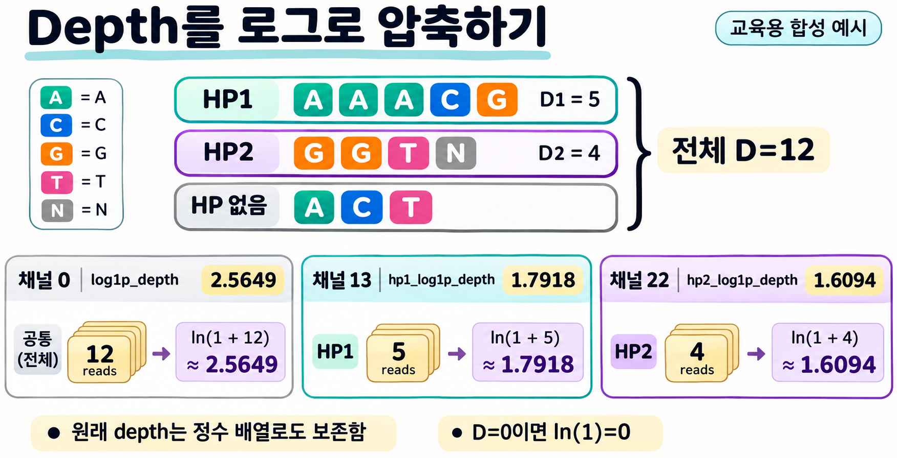

같은 위치의 원시 depth 12·5·4를 자연로그로 바꾸는 과정임. 원시 정수 개수는 보조 depth 배열에 별도 보존함.

| 채널 | 계산 예시 | 저장값 예시 |
|---|---|---:|
| 0 `log1p_depth` | `ln(1+12)` | 2.5649 |
| 13 `hp1_log1p_depth` | `ln(1+5)` | 1.7918 |
| 22 `hp2_log1p_depth` | `ln(1+4)` | 1.6094 |

### 11.2 정렬 위치의 평균 품질

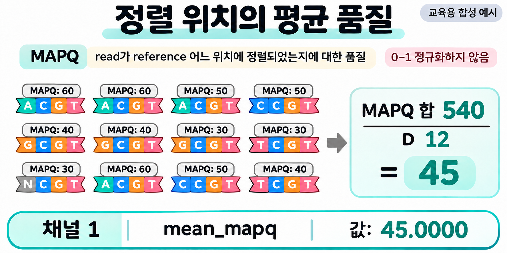

MAPQ는 정렬 위치의 품질임. 이 위치에 염기를 제공한 read 12개의 MAPQ 합은 540이며, 평균은 45임. 0–1 정규화를 하지 않음.

| 채널 | 계산 예시 | 저장값 예시 |
|---|---|---:|
| 1 `mean_mapq` | `540/12` | 45.0000 |

### 11.3 BQ가 있는 관측만 평균에 사용

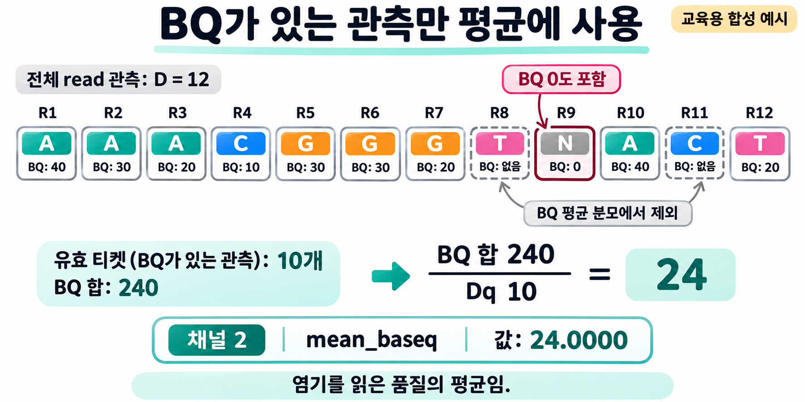

BQ는 관측 염기의 품질임. BQ 없음 2개는 평균 분모에서만 제외하며 base depth는 12로 유지함. BQ 0인 N 관측도 유효한 BQ 1개로 셈. 따라서 Dq=10·BQ 합240·평균24임. BQ 결측이라고 관측 염기를 N으로 바꾸지 않음.

| 채널 | 계산 예시 | 저장값 예시 |
|---|---|---:|
| 2 `mean_baseq` | `240/10` | 24.0000 |

### 11.4 Forward 방향의 관측 비율

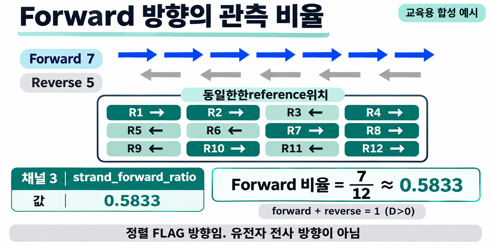

Forward read 관측 7개를 전체 12개로 나눈 비율임. 염색체 길이나 염기 종류의 개수가 아닌, 한 위치에서 read 정렬 방향을 세는 것임.

| 채널 | 계산 예시 | 저장값 예시 |
|---|---|---:|
| 3 `strand_forward_ratio` | `7/12` | 0.5833 |

### 11.5 Reverse 방향의 관측 비율

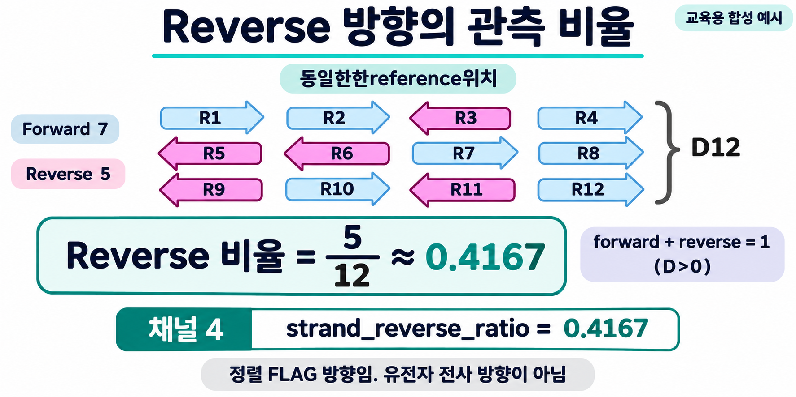

Reverse read 관측 5개를 전체 12개로 나눈 비율임. Depth가 양수일 때 forward와 reverse의 합이 1임. 유전자 전사 방향을 뜻하지 않음.

| 채널 | 계산 예시 | 저장값 예시 |
|---|---|---:|
| 4 `strand_reverse_ratio` | `5/12` | 0.4167 |

### 11.6 A 관측 비율: 전체와 HP별 비교

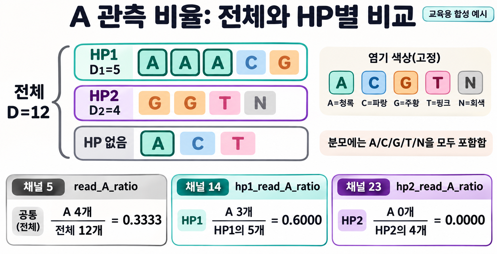

A는 공통4개·HP1 3개·HP2 0개임. HP 미지정 A 1개는 공통에만 포함함. HP2의 0/4는 관측이 없다는 뜻이 아니라 HP2 관측 안에 A가 없다는 뜻임.

| 채널 | 계산 예시 | 저장값 예시 |
|---|---|---:|
| 5 `read_A_ratio` | `4/12` | 0.3333 |
| 14 `hp1_read_A_ratio` | `3/5` | 0.6000 |
| 23 `hp2_read_A_ratio` | `0/4` | 0.0000 |

### 11.7 C 관측 비율: 전체와 HP별 비교

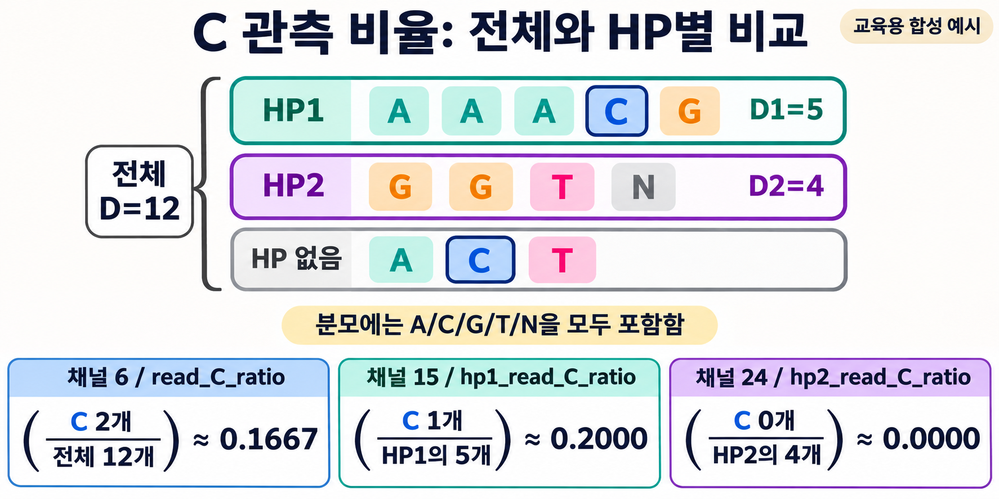

C는 공통2개·HP1 1개·HP2 0개임. HP 미지정 C 1개가 공통에 포함됨. HP별 분모를 전체 12로 나누지 않음.

| 채널 | 계산 예시 | 저장값 예시 |
|---|---|---:|
| 6 `read_C_ratio` | `2/12` | 0.1667 |
| 15 `hp1_read_C_ratio` | `1/5` | 0.2000 |
| 24 `hp2_read_C_ratio` | `0/4` | 0.0000 |

### 11.8 G 관측 비율: 전체와 HP별 비교

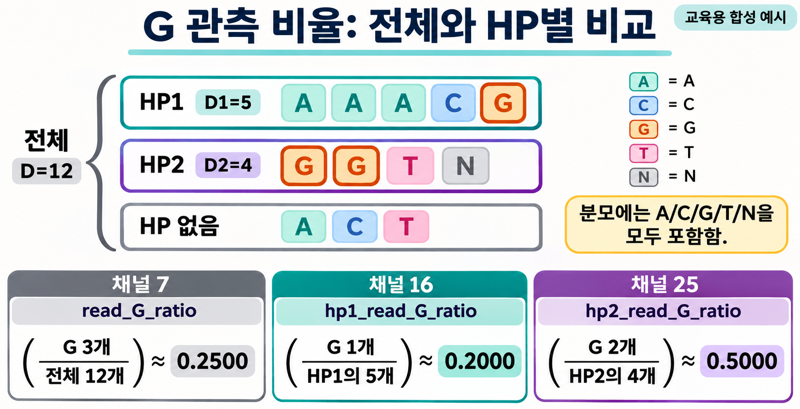

G는 공통3개·HP1 1개·HP2 2개임. 이 값은 VCF ALT 비율인 BAF와 분모가 다름. 해당 HP에 속한 모든 A/C/G/T/N이 HP별 분모임.

| 채널 | 계산 예시 | 저장값 예시 |
|---|---|---:|
| 7 `read_G_ratio` | `3/12` | 0.2500 |
| 16 `hp1_read_G_ratio` | `1/5` | 0.2000 |
| 25 `hp2_read_G_ratio` | `2/4` | 0.5000 |

### 11.9 T 관측 비율: 전체와 HP별 비교

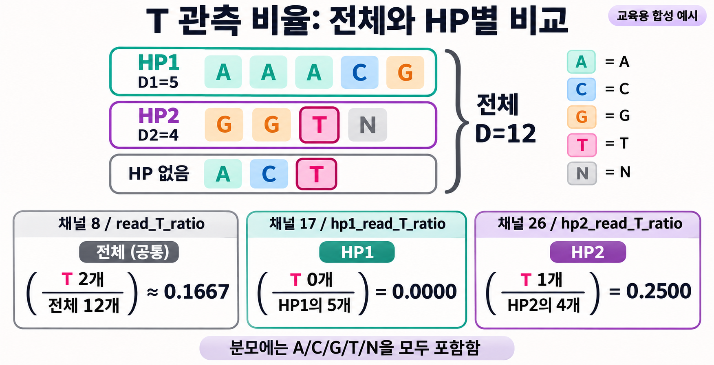

T는 공통2개·HP1 0개·HP2 1개임. HP 미지정 T 1개가 공통에 포함됨. HP1은 depth5가 존재하지만 T가 없어 0임.

| 채널 | 계산 예시 | 저장값 예시 |
|---|---|---:|
| 8 `read_T_ratio` | `2/12` | 0.1667 |
| 17 `hp1_read_T_ratio` | `0/5` | 0.0000 |
| 26 `hp2_read_T_ratio` | `1/4` | 0.2500 |

### 11.10 N 관측 비율: 전체와 HP별 비교

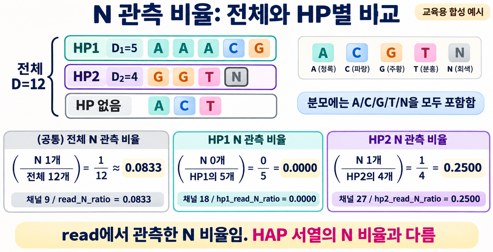

Read에서 N으로 관측한 것은 공통1개·HP1 0개·HP2 1개임. N도 base depth 분모에 포함함. HAP DNA의 N 함량과 별개의 관측 지표임.

| 채널 | 계산 예시 | 저장값 예시 |
|---|---|---:|
| 9 `read_N_ratio` | `1/12` | 0.0833 |
| 18 `hp1_read_N_ratio` | `0/5` | 0.0000 |
| 27 `hp2_read_N_ratio` | `1/4` | 0.2500 |

### 11.11 삽입은 염기 길이가 아닌 사건 수

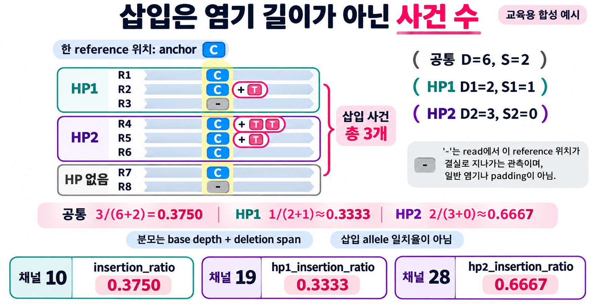

C anchor의 삽입 사건은 공통3개·HP1 1개·HP2 2개임. 삽입 길이가 2bp인 TT도 사건은 1개임. 분모는 base depth와 해당 위치를 결실로 지나가는 관측 수의 합임. 이 지지는 HAP 삽입 allele과의 정확한 서열 일치율이 아님.

| 채널 | 계산 예시 | 저장값 예시 |
|---|---|---:|
| 10 `insertion_ratio` | `3/(6+2)` | 0.3750 |
| 19 `hp1_insertion_ratio` | `1/(2+1)` | 0.3333 |
| 28 `hp2_insertion_ratio` | `2/(3+0)` | 0.6667 |

### 11.12 이 anchor 뒤에서 시작한 결실만 세기

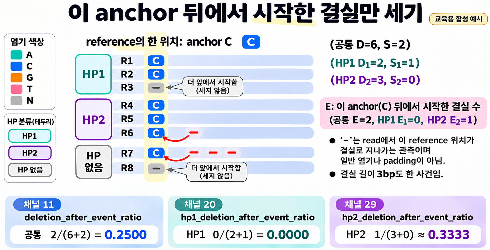

C 바로 뒤에서 시작한 결실은 HP2의 1bp 사건과 HP 미지정의 3bp 사건, 총2개임. HP1의 결실은 더 앞에서 시작하므로 C anchor의 사건 수는 0임. C 자체를 결실로 지나가는 S와 C 뒤에서 시작하는 E를 구분함.

| 채널 | 계산 예시 | 저장값 예시 |
|---|---|---:|
| 11 `deletion_after_event_ratio` | `2/(6+2)` | 0.2500 |
| 20 `hp1_deletion_after_event_ratio` | `0/(2+1)` | 0.0000 |
| 29 `hp2_deletion_after_event_ratio` | `1/(3+0)` | 0.3333 |

### 11.13 결실 길이의 최댓값: 합계가 아님

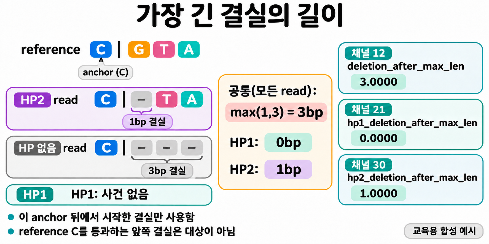

C anchor 뒤에서 시작한 결실 길이만 비교함. 공통은 1bp·3bp 중 최댓값3bp, HP1은 해당 사건이 없어0bp, HP2는1bp임. 길이의 합4bp나 평균2bp를 저장하는 채널이 아님.

| 채널 | 계산 예시 | 저장값 예시 |
|---|---|---:|
| 12 `deletion_after_max_len` | `max(1,3) bp` | 3.0000 |
| 21 `hp1_deletion_after_max_len` | `사건 없음 → 0 bp` | 0.0000 |
| 30 `hp2_deletion_after_max_len` | `max(1) bp` | 1.0000 |

### 11.14 VCF REF allele의 관측 비율

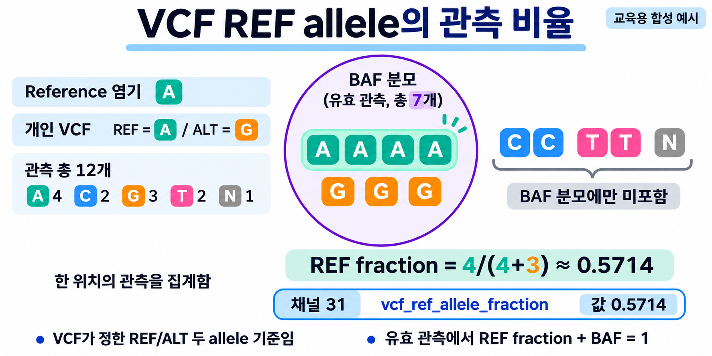

VCF REF=A·ALT=G를 사용함. A4개와 G3개, 총7개만 이 계산의 분모임. C2·T2·N1은 관측 데이터에 남지만 이 분모에는 포함하지 않음.

| 채널 | 계산 예시 | 저장값 예시 |
|---|---|---:|
| 31 `vcf_ref_allele_fraction` | `4/(4+3)` | 0.5714 |

### 11.15 BAF: VCF ALT를 지지한 비율

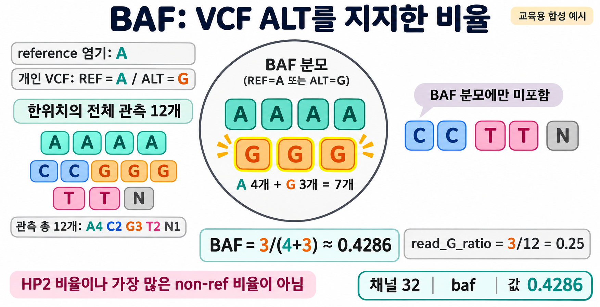

VCF ALT인 G3개를 REF A4개+ALT G3개로 나누므로 BAF=3/7임. read_G_ratio=3/12와 구분함. HP2 read 비율이나 최대 non-ref 비율을 BAF로 정의하지 않음.

| 채널 | 계산 예시 | 저장값 예시 |
|---|---|---:|
| 32 `baf` | `3/(4+3)` | 0.4286 |

### 11.16 Minor allele은 관측이 적은 쪽

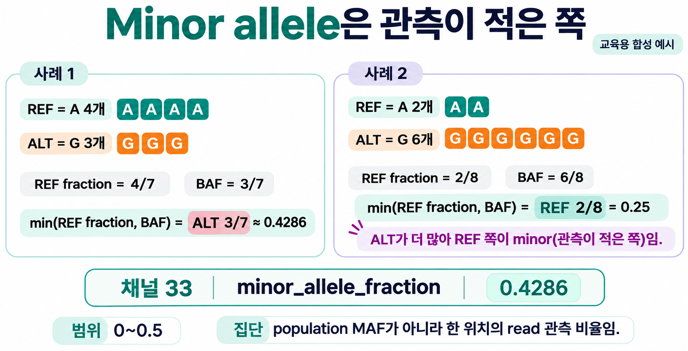

기본 사례에서는 REF4·ALT3이므로 ALT 쪽3/7이 작은 값임. 별도 사례 REF2·ALT6에서는 BAF=0.75이지만 minor fraction=0.25로 REF 쪽이 선택됨. 집단 population MAF가 아닌 한 위치의 read 관측 지표임.

| 채널 | 계산 예시 | 저장값 예시 |
|---|---|---:|
| 33 `minor_allele_fraction` | `min(4/7, 3/7)` | 0.4286 |

그림 오른쪽의 별도 사례는 REF2·ALT6으로, 실제 코드에서도 BAF=0.75·minor fraction=0.25를 확인함.

### 11.17 가장 많은 non-reference 한 종류

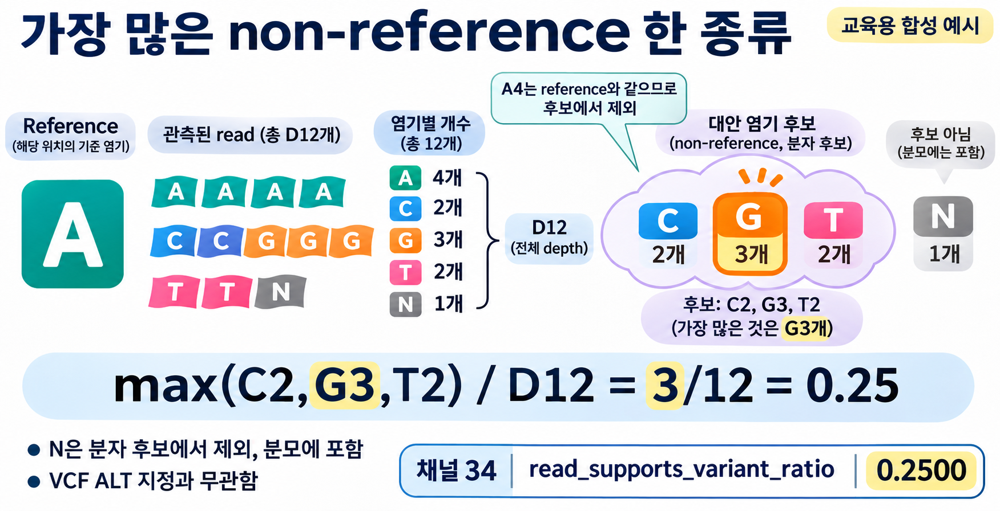

Reference A와 다른 A/C/G/T 후보 C2·G3·T2 중 가장 많은 G3만 분자임. N1은 후보에서 제외하되 전체 depth12에는 포함함. VCF ALT 지정 여부와 무관함.

| 채널 | 계산 예시 | 저장값 예시 |
|---|---|---:|
| 34 `read_supports_variant_ratio` | `max(2,3,2)/12` | 0.2500 |

### 11.18 Reference와 다른 관측을 모두 합하기

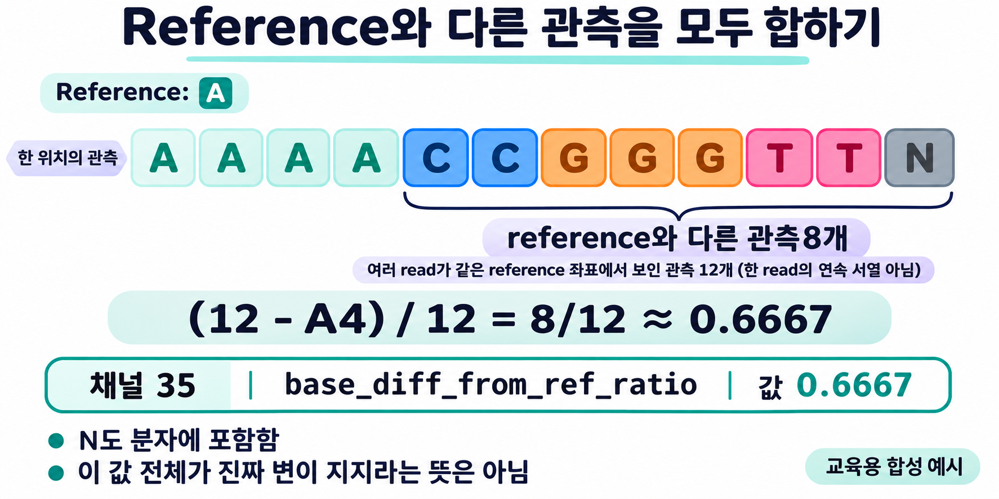

Reference A와 다른 C2+G3+T2+N1을 전부 더하면8개임. N까지 분자에 들어가므로 이 수치 전체를 확정된 변이 지지로 해석하지 않음.

| 채널 | 계산 예시 | 저장값 예시 |
|---|---|---:|
| 35 `base_diff_from_ref_ratio` | `(12−4)/12` | 0.6667 |

비율의 분모가 0인 경우·BQ 결측·BAF 미지원 site·HAP 삽입·padding의 0은 8절의 보조 배열로 구분함. 이 그림을 추가하면서 채널 수·계산식·필터·저장 정책을 바꾸지 않음.

그림 생성에는 imagegen 내장 도구를 사용함. [생성·교정 요청문 기록](figures/pileup36_details/prompts.json)을 함께 보존함.
