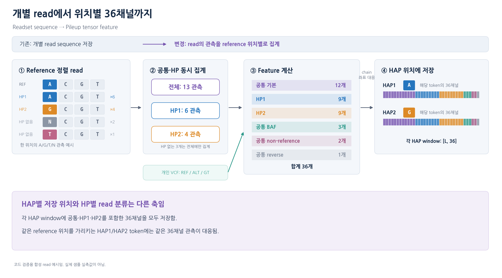
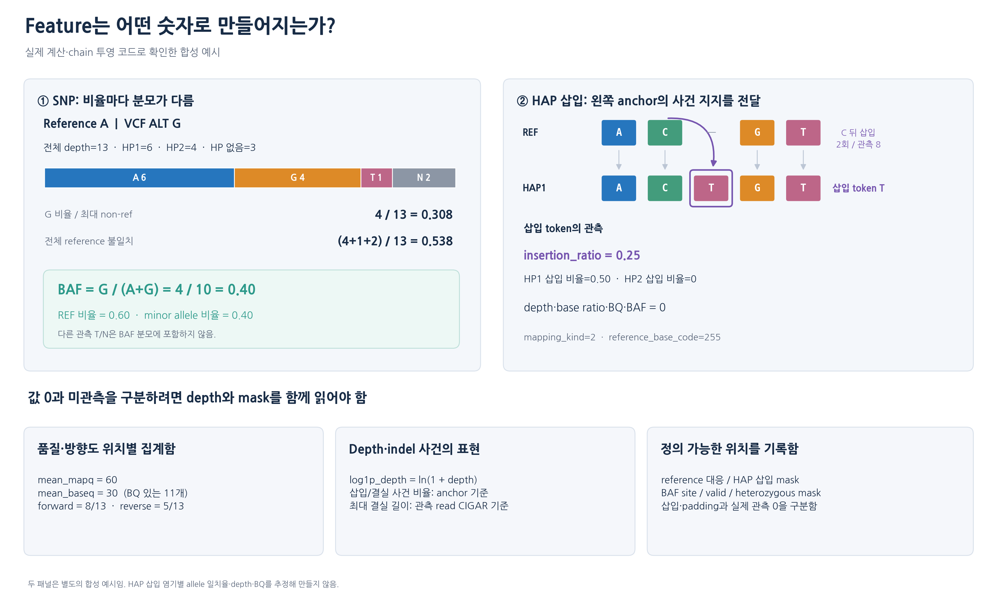

# Readset → Pileup36 변경 코드

- 기존 readset과 새 pileup tensor의 변경 부분을 검토하기 위한 코드 원문·발췌본임.
- code/01_pileup_원문: 계산·36채널·VCF/좌표·저장·source 검증 원문임.
- code/02_readset_발췌: 비교 대상인 기존 readset 저장 부분임.
- code/03_연결부_발췌: 모드 선택·호출·reader·완료 검사 변경부임.
- code/04_검사_원문: 새 feature 수동 정답·저장·검증 테스트임.
- 출처·줄번호·복사/발췌 구분·SHA256은 파일목록.csv에 있음.

발췌본 단독 실행은 지원하지 않으며, 실제 실행은 전체 전달본의 진입점을 사용함.

## Feature 생성 그림

그림은 실제 계산·투영 코드로 수치를 확인한 합성 예시임. SVG 원본도 figures/에 포함함.
